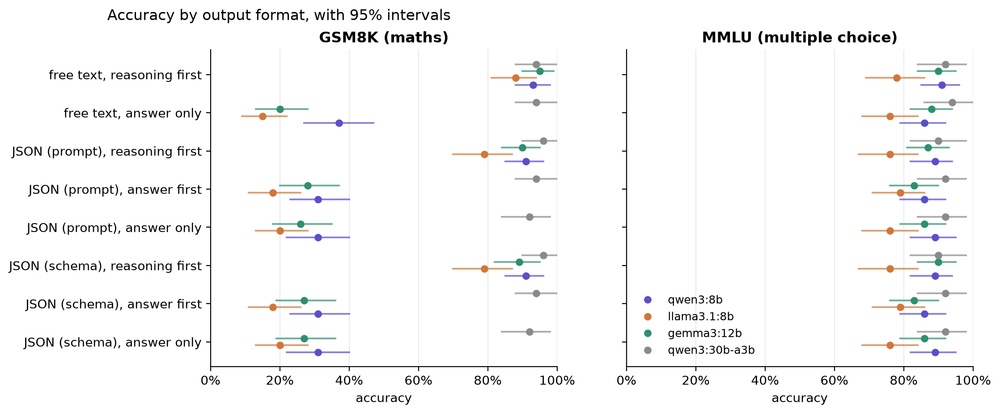
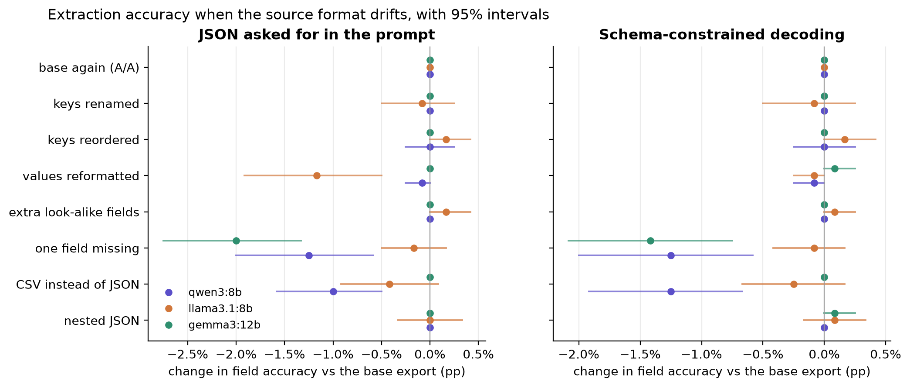

# format-tax

<a href="pyproject.toml"></a> <a href="LICENSE"></a>

**Question.** Production code asks models for JSON all the time. Does asking for JSON cost accuracy, and
if so, is it the JSON or where the reasoning goes inside it? Does schema-constrained decoding help or
hurt? And when the source data a model extracts from drifts (keys renamed, values reformatted, a field
missing, CSV instead of JSON), how much breaks?

This repository is a measurement study with local open-weight models. Every number in
[reports/results.md](reports/results.md) is produced by the code here from cached model calls, so it
regenerates exactly. The 17 predictions were committed before the full run, and are scored in a dated
addendum: [HYPOTHESES.md](HYPOTHESES.md). 15 held and 2 failed.

## Findings

Numbers are from [reports/results.md](reports/results.md): 95% bootstrap intervals over items, `pp` =
percentage points. Models: `qwen3:8b`, `llama3.1:8b` and `gemma3:12b` on everything; `qwen3:30b-a3b`
(thinking on) on the first 50 GSM8K and 50 MMLU items.

**Part A: the format tax.** 100 GSM8K maths problems and 100 MMLU questions, 8 output formats each.

- **The tax is about order, not JSON.** On GSM8K, JSON with the reasoning written before the answer
  costs −2 [−8, +3] pp for `qwen3:8b` and −5 [−11, 0] for `gemma3:12b` against free text with
  reasoning. Putting `"answer"` before `"reasoning"` costs −60, −61 and −62 pp, and lands within 2 pp of
  giving no reasoning at all: the reasoning written after the answer is thrown away.
- **Llama pays a real tax even with the reasoning first:** −9 [−17, −1] pp. Its reasoning inside a JSON
  string is shorter (125 tokens against 211), and 8 of 100 replies contain only a plan ("First,
  calculate… Then…") with no arithmetic, against none in free text. This prediction failed.
- **Answer-first replies know they are wrong.** In 29–41% of answer-first GSM8K replies, the reasoning
  that follows ends on a different number from the committed answer, and that later number is the
  correct one in 56 of 67 cases; the committed answer is right in 1. Gemma and Llama then often loop
  trying to reconcile the two ("I am still getting 80. I must be misinterpreting something.") and hit the
  1,024-token cap on 47% and 44% of answer-first replies, against 1% and 0% with the reasoning first.
- **Schema-constrained decoding is a format guarantee, not an accuracy lever.** Constrained minus
  prompt-only averages +0.3, −0.2 and +0.2 pp across the three JSON shapes. At temperature 0, qwen3 and
  Llama write the same Part A reply in 582 and 587 of 600 pairs and the same answer in 598 and 596; for
  the thinking model the text differs in 237 of 300 pairs and the answer in none. What the schema buys is validity: every reply that was not cut off is one
  bare JSON object, where Gemma wraps 100% of its prompt-only JSON in a code fence.
- **MMLU barely notices**, because a one-letter answer needs little reasoning: JSON with the reasoning
  first is within 3 pp of free text with reasoning for the three small models, and putting the answer
  first costs between −7 and +1 pp instead of 60.
- **Thinking removes the order effect.** `qwen3:30b-a3b` reasons before it writes anything, so
  answer-first JSON is within 2 pp of reasoning-first (−2 [−8, +4]).

**Part B: schema drift.** 150 E2E restaurant records converted to one fixed target schema, each shown in
9 source formats, in both output modes.

- **Extraction is robust to most drift.** Base field accuracy is 99.6–99.8%. Renamed keys, reordered
  keys, nested JSON, CSV and look-alike extra fields (a second name, a second landmark) each move it by
  at most 1.2 pp; no model took a look-alike value in any of 150 records.
- **Reformatted values hurt only Llama**, and only in prompt-only mode: shown "20-25 GBP" or "3/5", it
  copies the source format instead of the allowed value listed in the prompt, losing 18 pp on rating and
  16 pp on price. The schema's enum removes the whole drop. This prediction (two models, ≥10 pp) failed.
- **A missing field gets invented, and it is nearly always one field.** With one field removed, Gemma
  fills it in 16% of records and qwen3 in 11%, against 2–2.5% for fields the record never had. Almost all
  of it is `eat_type`: with it removed, Gemma writes "restaurant" in 24 of 24 records and qwen3 in 17 of
  24. The same invention is the only kind of error on the base records.
- **Noise floor:** sending the same request twice changed 0 of 150 Part B answers for every model and
  mode, and at most 2 of 100 Part A answers (2 of 50 for the thinking model).





## Design

- **Part A conditions:** free text with reasoning; free text, answer only; and JSON in three shapes
  (`{"reasoning", "answer"}`, `{"answer", "reasoning"}`, `{"answer"}`), each asked for in the prompt and
  again with Ollama's `format` schema (identical prompt text). Ollama generates properties in schema
  order, so the schema enforces the order too. Two A/A repeats: free text with reasoning, and schema
  JSON with reasoning first.
- **Part A scoring:** JSON is parsed leniently (the first JSON object in the reply, so code fences are
  tolerated) and a reply with no usable answer counts as wrong. Also reported: strict validity, the
  value written after `"answer":` even when the JSON never closed ("as written"), how many invalid
  replies a free-text parser would have scored right, truncations and output tokens.
- **Part B source formats:** the base JSON export, its A/A repeat, keys renamed (`priceRange` →
  `price_band`…), keys reordered, values reformatted (`£20-25` → `20-25 GBP`, `3 out of 5` → `3/5`,
  `yes` → `Y`), extra look-alike fields, one field removed, CSV, and nested JSON. Missing fields must be
  `null`. Scoring is per field, normalising case, accents and punctuation; `family_friendly` accepts
  true/false or yes/no.
- **Caps:** 1,024 output tokens for GSM8K, 768 for MMLU, 300 for Part B, and 4,096 for the thinking
  model, so a reasoning-first reply is not cut off before its answer.
- **Statistics:** paired contrasts with a 95% percentile bootstrap over items (2,000 draws).

## Reproduce

Requires [uv](https://docs.astral.sh/uv/) and [Ollama](https://ollama.com) with the models pulled.

```sh
uv sync
uv run ftax fetch          # pinned Hugging Face files, sha256-checked
uv run ftax items          # data/items.jsonl: 350 main items and 30 pilot items, seeded
uv run ftax run --models qwen3:8b,llama3.1:8b,gemma3:12b
uv run ftax run --models qwen3:30b-a3b --tasks gsm8k,mmlu --per-task 50
uv run ftax show gsm8k-0031     # one item's prompts and outputs
uv run ftax report              # reports/results.md and reports/figures/
uv run pytest
```

Every model call is cached in `cache/llm.sqlite`, keyed by model, messages, options, schema and a repeat
tag (an A/A repeat is a real second call). With the cache present, `ftax run ... --cache-only` rebuilds
`results/answers/` without a server, and `report` re-parses every stored output.

Runtime: 15,100 calls in the grid plus 456 in the pilot. The three small models took about 12 hours
(2026-10-31 13:30 to 2026-11-01 01:46); the thinking model took 13 hours, of which about 9.7 were the
machine asleep after the charger came out.

## Data and models

| Item | Source | Version | Licence |
|---|---|---|---|
| GSM8K test | Hugging Face `openai/gsm8k` | commit `740312add88f781978c0658806c59bc2815b9866` | MIT |
| MMLU test (4 high-school subjects) | Hugging Face `cais/mmlu` | commit `c30699e8356da336a370243923dbaf21066bb9fe` | MIT |
| E2E NLG (cleaned) test | Hugging Face `tuetschek/e2e_nlg_cleaned` (parquet conversion) | commit `6f77a74f6ce3095770924452f3f1b9631f837535` | CC BY-SA 4.0 |
| Models | Ollama library tags `qwen3:8b`, `llama3.1:8b`, `gemma3:12b`, `qwen3:30b-a3b` (Q4_K_M), server 0.40.13 | digests in `results/models.json` | Apache 2.0 (Qwen3), Llama 3.1 Community Licence, Gemma Terms of Use |

The GSM8K and MMLU items are the same seeded draws as
[prompt-brittleness](https://github.com/Srikarmk/prompt-brittleness). Settings: temperature 0, seed 7,
`num_ctx` 4096; `think: false` for `qwen3:8b` and `think: true` for `qwen3:30b-a3b`, whose final answer
alone is parsed.

## Layout

```
src/ftax/   config, data (fetch, item sampling), prompts (conditions, schemas, drift variants), parse
            (answer and field checking), llm (Ollama + disk cache), runner, stats, analysis, report, cli
tests/      parsers on hand cases, template and variant rendering
data/       items.jsonl and sources.json (files, revisions, sha256)
results/    answers/<model>.jsonl (one row per call) and models.json (digests, settings)
reports/    results.md, results_pilot.md and figures/
cache/      llm.sqlite: every model call
```

## Limits

- Small local models, 4-bit, temperature 0, one seed. Constrained decoding interacts with sampling: at
  temperature 0 a schema can only change the output where the model's top token would break it, so
  "constraint is neutral" may not hold with sampling or for a hosted provider's implementation.
- One prompt template per condition and one target schema. Key names (`reasoning`, `answer`) and their
  wording are fixed; other names or field descriptions could change the reasoning a model writes.
- The 30B thinking model ran on 50 items per task, so its intervals are wide, and "larger" and "thinks
  first" are confounded.
- Part B is near ceiling for all three models, which makes most drift contrasts small by construction; a
  harder extraction task (free-text sources, more fields) could separate the drifts more.
- The answer-first self-contradiction count compares the committed answer with the last number in the
  reasoning, which is a heuristic; the runaway and plan-only observations come from reading failures and
  were not pre-registered.
- Server timings include long stretches on battery and asleep; they are not benchmarks.

## License

MIT for the code. The datasets and models keep their own licences (table above).
