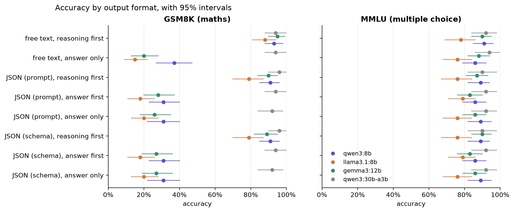
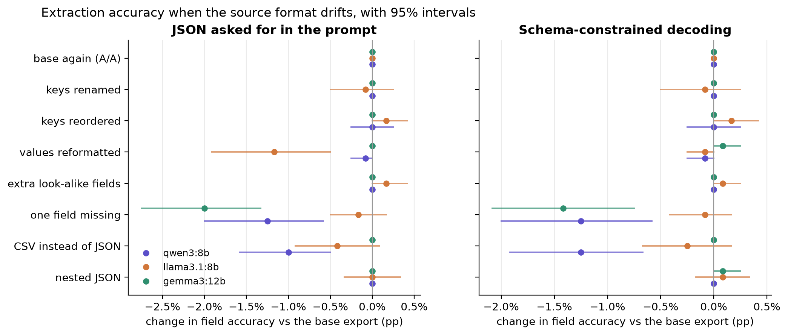

# Results (main items)

Generated by `ftax report` from `results/answers/`. Intervals are 95% item bootstraps (2,000 draws).

## Part A: accuracy by output format

### gsm8k

| condition | qwen3:8b | llama3.1:8b | gemma3:12b | qwen3:30b-a3b |
|---|---|---|---|---|
| free text, reasoning first | 93% (n=100, 275 tok) | 88% (n=100, 211 tok) | 95% (n=100, 245 tok) | 94% (n=50, 1113 tok) |
| free text, answer only | 37% (n=100, 21 tok) | 15% (n=100, 5 tok) | 20% (n=100, 7 tok) | 94% (n=50, 620 tok) |
| JSON (prompt), reasoning first | 91% (n=100, 136 tok) | 79% (n=100, 125 tok) | 90% (n=100, 195 tok) | 96% (n=50, 821 tok) |
| JSON (prompt), answer first | 31% (n=100, 189 tok) | 18% (n=100, 527 tok) | 28% (n=100, 589 tok) | 94% (n=50, 856 tok) |
| JSON (prompt), answer only | 31% (n=100, 10 tok) | 20% (n=100, 10 tok) | 26% (n=100, 18 tok) | 92% (n=50, 633 tok) |
| JSON (schema), reasoning first | 91% (n=100, 136 tok) | 79% (n=100, 125 tok) | 89% (n=100, 183 tok) | 96% (n=50, 824 tok) |
| JSON (schema), answer first | 31% (n=100, 189 tok) | 18% (n=100, 510 tok) | 27% (n=100, 642 tok) | 94% (n=50, 857 tok) |
| JSON (schema), answer only | 31% (n=100, 10 tok) | 20% (n=100, 10 tok) | 27% (n=100, 9 tok) | 92% (n=50, 624 tok) |
| free text, reasoning first (A/A) | 93% (n=100, 275 tok) | 88% (n=100, 211 tok) | 95% (n=100, 244 tok) | 94% (n=50, 1113 tok) |
| JSON (schema), reasoning first (A/A) | 91% (n=100, 136 tok) | 79% (n=100, 125 tok) | 89% (n=100, 183 tok) | 96% (n=50, 815 tok) |

### mmlu

| condition | qwen3:8b | llama3.1:8b | gemma3:12b | qwen3:30b-a3b |
|---|---|---|---|---|
| free text, reasoning first | 91% (n=100, 395 tok) | 78% (n=100, 298 tok) | 90% (n=100, 301 tok) | 92% (n=50, 1391 tok) |
| free text, answer only | 86% (n=100, 4 tok) | 76% (n=100, 4 tok) | 88% (n=100, 4 tok) | 94% (n=50, 794 tok) |
| JSON (prompt), reasoning first | 89% (n=100, 115 tok) | 76% (n=100, 116 tok) | 87% (n=100, 211 tok) | 90% (n=50, 1118 tok) |
| JSON (prompt), answer first | 86% (n=100, 114 tok) | 79% (n=100, 132 tok) | 83% (n=100, 200 tok) | 92% (n=50, 1109 tok) |
| JSON (prompt), answer only | 89% (n=100, 7 tok) | 76% (n=100, 10 tok) | 86% (n=100, 17 tok) | 92% (n=50, 813 tok) |
| JSON (schema), reasoning first | 89% (n=100, 114 tok) | 76% (n=100, 117 tok) | 90% (n=100, 204 tok) | 90% (n=50, 1111 tok) |
| JSON (schema), answer first | 86% (n=100, 114 tok) | 79% (n=100, 132 tok) | 83% (n=100, 175 tok) | 92% (n=50, 1083 tok) |
| JSON (schema), answer only | 89% (n=100, 7 tok) | 76% (n=100, 10 tok) | 86% (n=100, 7 tok) | 92% (n=50, 820 tok) |
| free text, reasoning first (A/A) | 90% (n=100, 393 tok) | 78% (n=100, 299 tok) | 90% (n=100, 302 tok) | 92% (n=50, 1386 tok) |
| JSON (schema), reasoning first (A/A) | 89% (n=100, 114 tok) | 76% (n=100, 117 tok) | 90% (n=100, 204 tok) | 90% (n=50, 1123 tok) |

## Part A: contrasts (pp, paired by item)

| task | model | contrast | diff | 95% CI | n |
|---|---|---|---|---|---|
| gsm8k | qwen3:8b | reasoning helps (free text) | +56.0 | [+46.0, +66.0] | 100 |
| gsm8k | qwen3:8b | JSON tax, reasoning first (prompt) | -2.0 | [-8.0, +3.0] | 100 |
| gsm8k | qwen3:8b | JSON tax, reasoning first (schema) | -2.0 | [-8.0, +3.0] | 100 |
| gsm8k | qwen3:8b | answer first vs reasoning first (prompt) | -60.0 | [-69.0, -49.0] | 100 |
| gsm8k | qwen3:8b | answer first vs reasoning first (schema) | -60.0 | [-69.0, -49.0] | 100 |
| gsm8k | qwen3:8b | answer first vs answer only (prompt) | +0.0 | [-5.0, +6.0] | 100 |
| gsm8k | qwen3:8b | JSON tax, answer only (prompt) | -6.0 | [-13.0, +0.0] | 100 |
| gsm8k | qwen3:8b | schema vs prompt, reasoning first | +0.0 | [+0.0, +0.0] | 100 |
| gsm8k | qwen3:8b | schema vs prompt, answer first | +0.0 | [+0.0, +0.0] | 100 |
| gsm8k | qwen3:8b | schema vs prompt, answer only | +0.0 | [+0.0, +0.0] | 100 |
| gsm8k | llama3.1:8b | reasoning helps (free text) | +73.0 | [+64.0, +81.0] | 100 |
| gsm8k | llama3.1:8b | JSON tax, reasoning first (prompt) | -9.0 | [-17.0, -1.0] | 100 |
| gsm8k | llama3.1:8b | JSON tax, reasoning first (schema) | -9.0 | [-17.0, -1.0] | 100 |
| gsm8k | llama3.1:8b | answer first vs reasoning first (prompt) | -61.0 | [-70.0, -51.0] | 100 |
| gsm8k | llama3.1:8b | answer first vs reasoning first (schema) | -61.0 | [-70.0, -51.0] | 100 |
| gsm8k | llama3.1:8b | answer first vs answer only (prompt) | -2.0 | [-8.0, +4.0] | 100 |
| gsm8k | llama3.1:8b | JSON tax, answer only (prompt) | +5.0 | [+1.0, +10.0] | 100 |
| gsm8k | llama3.1:8b | schema vs prompt, reasoning first | +0.0 | [+0.0, +0.0] | 100 |
| gsm8k | llama3.1:8b | schema vs prompt, answer first | +0.0 | [+0.0, +0.0] | 100 |
| gsm8k | llama3.1:8b | schema vs prompt, answer only | +0.0 | [+0.0, +0.0] | 100 |
| gsm8k | gemma3:12b | reasoning helps (free text) | +75.0 | [+65.0, +84.0] | 100 |
| gsm8k | gemma3:12b | JSON tax, reasoning first (prompt) | -5.0 | [-11.0, +0.0] | 100 |
| gsm8k | gemma3:12b | JSON tax, reasoning first (schema) | -6.0 | [-13.0, +0.0] | 100 |
| gsm8k | gemma3:12b | answer first vs reasoning first (prompt) | -62.0 | [-72.0, -51.0] | 100 |
| gsm8k | gemma3:12b | answer first vs reasoning first (schema) | -62.0 | [-72.0, -51.0] | 100 |
| gsm8k | gemma3:12b | answer first vs answer only (prompt) | +2.0 | [-3.0, +8.0] | 100 |
| gsm8k | gemma3:12b | JSON tax, answer only (prompt) | +6.0 | [+0.0, +12.0] | 100 |
| gsm8k | gemma3:12b | schema vs prompt, reasoning first | -1.0 | [-5.0, +3.0] | 100 |
| gsm8k | gemma3:12b | schema vs prompt, answer first | -1.0 | [-6.0, +3.0] | 100 |
| gsm8k | gemma3:12b | schema vs prompt, answer only | +1.0 | [-4.0, +6.0] | 100 |
| gsm8k | qwen3:30b-a3b | reasoning helps (free text) | +0.0 | [-6.0, +6.0] | 50 |
| gsm8k | qwen3:30b-a3b | JSON tax, reasoning first (prompt) | +2.0 | [-4.0, +8.0] | 50 |
| gsm8k | qwen3:30b-a3b | JSON tax, reasoning first (schema) | +2.0 | [-4.0, +8.0] | 50 |
| gsm8k | qwen3:30b-a3b | answer first vs reasoning first (prompt) | -2.0 | [-8.0, +4.0] | 50 |
| gsm8k | qwen3:30b-a3b | answer first vs reasoning first (schema) | -2.0 | [-8.0, +4.0] | 50 |
| gsm8k | qwen3:30b-a3b | answer first vs answer only (prompt) | +2.0 | [-4.0, +8.0] | 50 |
| gsm8k | qwen3:30b-a3b | JSON tax, answer only (prompt) | -2.0 | [-8.0, +4.0] | 50 |
| gsm8k | qwen3:30b-a3b | schema vs prompt, reasoning first | +0.0 | [+0.0, +0.0] | 50 |
| gsm8k | qwen3:30b-a3b | schema vs prompt, answer first | +0.0 | [+0.0, +0.0] | 50 |
| gsm8k | qwen3:30b-a3b | schema vs prompt, answer only | +0.0 | [+0.0, +0.0] | 50 |
| mmlu | qwen3:8b | reasoning helps (free text) | +5.0 | [-2.0, +12.0] | 100 |
| mmlu | qwen3:8b | JSON tax, reasoning first (prompt) | -2.0 | [-7.0, +4.0] | 100 |
| mmlu | qwen3:8b | JSON tax, reasoning first (schema) | -2.0 | [-7.0, +4.0] | 100 |
| mmlu | qwen3:8b | answer first vs reasoning first (prompt) | -3.0 | [-9.0, +3.0] | 100 |
| mmlu | qwen3:8b | answer first vs reasoning first (schema) | -3.0 | [-9.0, +3.0] | 100 |
| mmlu | qwen3:8b | answer first vs answer only (prompt) | -3.0 | [-7.0, +0.0] | 100 |
| mmlu | qwen3:8b | JSON tax, answer only (prompt) | +3.0 | [+0.0, +6.0] | 100 |
| mmlu | qwen3:8b | schema vs prompt, reasoning first | +0.0 | [+0.0, +0.0] | 100 |
| mmlu | qwen3:8b | schema vs prompt, answer first | +0.0 | [+0.0, +0.0] | 100 |
| mmlu | qwen3:8b | schema vs prompt, answer only | +0.0 | [+0.0, +0.0] | 100 |
| mmlu | llama3.1:8b | reasoning helps (free text) | +2.0 | [-6.0, +10.0] | 100 |
| mmlu | llama3.1:8b | JSON tax, reasoning first (prompt) | -2.0 | [-8.0, +4.0] | 100 |
| mmlu | llama3.1:8b | JSON tax, reasoning first (schema) | -2.0 | [-8.0, +4.0] | 100 |
| mmlu | llama3.1:8b | answer first vs reasoning first (prompt) | +3.0 | [-5.0, +11.0] | 100 |
| mmlu | llama3.1:8b | answer first vs reasoning first (schema) | +3.0 | [-5.0, +11.0] | 100 |
| mmlu | llama3.1:8b | answer first vs answer only (prompt) | +3.0 | [-1.0, +8.0] | 100 |
| mmlu | llama3.1:8b | JSON tax, answer only (prompt) | +0.0 | [-5.0, +5.0] | 100 |
| mmlu | llama3.1:8b | schema vs prompt, reasoning first | +0.0 | [+0.0, +0.0] | 100 |
| mmlu | llama3.1:8b | schema vs prompt, answer first | +0.0 | [+0.0, +0.0] | 100 |
| mmlu | llama3.1:8b | schema vs prompt, answer only | +0.0 | [+0.0, +0.0] | 100 |
| mmlu | gemma3:12b | reasoning helps (free text) | +2.0 | [-3.0, +8.0] | 100 |
| mmlu | gemma3:12b | JSON tax, reasoning first (prompt) | -3.0 | [-9.0, +3.0] | 100 |
| mmlu | gemma3:12b | JSON tax, reasoning first (schema) | +0.0 | [-5.0, +6.0] | 100 |
| mmlu | gemma3:12b | answer first vs reasoning first (prompt) | -4.0 | [-10.0, +1.0] | 100 |
| mmlu | gemma3:12b | answer first vs reasoning first (schema) | -7.0 | [-14.0, -1.0] | 100 |
| mmlu | gemma3:12b | answer first vs answer only (prompt) | -3.0 | [-7.0, +0.0] | 100 |
| mmlu | gemma3:12b | JSON tax, answer only (prompt) | -2.0 | [-5.0, +0.0] | 100 |
| mmlu | gemma3:12b | schema vs prompt, reasoning first | +3.0 | [-2.0, +8.0] | 100 |
| mmlu | gemma3:12b | schema vs prompt, answer first | +0.0 | [+0.0, +0.0] | 100 |
| mmlu | gemma3:12b | schema vs prompt, answer only | +0.0 | [+0.0, +0.0] | 100 |
| mmlu | qwen3:30b-a3b | reasoning helps (free text) | -2.0 | [-6.0, +0.0] | 50 |
| mmlu | qwen3:30b-a3b | JSON tax, reasoning first (prompt) | -2.0 | [-6.0, +0.0] | 50 |
| mmlu | qwen3:30b-a3b | JSON tax, reasoning first (schema) | -2.0 | [-6.0, +0.0] | 50 |
| mmlu | qwen3:30b-a3b | answer first vs reasoning first (prompt) | +2.0 | [+0.0, +6.0] | 50 |
| mmlu | qwen3:30b-a3b | answer first vs reasoning first (schema) | +2.0 | [+0.0, +6.0] | 50 |
| mmlu | qwen3:30b-a3b | answer first vs answer only (prompt) | +0.0 | [-8.0, +8.0] | 50 |
| mmlu | qwen3:30b-a3b | JSON tax, answer only (prompt) | -2.0 | [-6.0, +0.0] | 50 |
| mmlu | qwen3:30b-a3b | schema vs prompt, reasoning first | +0.0 | [+0.0, +0.0] | 50 |
| mmlu | qwen3:30b-a3b | schema vs prompt, answer first | +0.0 | [+0.0, +0.0] | 50 |
| mmlu | qwen3:30b-a3b | schema vs prompt, answer only | +0.0 | [+0.0, +0.0] | 50 |

## Part A: JSON validity

`accuracy` counts a reply with no valid JSON answer as wrong; `as written` scores the value written after `"answer":` even when the JSON never closed. `found` = a JSON object with a usable answer anywhere in the reply; `strict` = the whole reply is that object; `rescued` = invalid replies a free-text parser would have scored right.

| task | model | condition | accuracy | as written | found | strict | rescued | truncated |
|---|---|---|---|---|---|---|---|---|
| gsm8k | gemma3:12b | JSON (prompt), answer first | 28% | 28% | 51% | 0% | 15 | 47 |
| gsm8k | gemma3:12b | JSON (prompt), reasoning first | 90% | 91% | 98% | 0% | 2 | 1 |
| gsm8k | gemma3:12b | JSON (prompt), answer only | 26% | 26% | 100% | 0% | 0 | 0 |
| gsm8k | gemma3:12b | JSON (schema), answer first | 27% | 27% | 45% | 45% | 13 | 55 |
| gsm8k | gemma3:12b | JSON (schema), reasoning first | 89% | 89% | 99% | 99% | 0 | 1 |
| gsm8k | gemma3:12b | JSON (schema), answer only | 27% | 27% | 100% | 100% | 0 | 0 |
| mmlu | gemma3:12b | JSON (prompt), answer first | 83% | 83% | 100% | 0% | 0 | 0 |
| mmlu | gemma3:12b | JSON (prompt), reasoning first | 87% | 87% | 100% | 0% | 0 | 0 |
| mmlu | gemma3:12b | JSON (prompt), answer only | 86% | 86% | 100% | 0% | 0 | 0 |
| mmlu | gemma3:12b | JSON (schema), answer first | 83% | 83% | 100% | 100% | 0 | 0 |
| mmlu | gemma3:12b | JSON (schema), reasoning first | 90% | 90% | 100% | 100% | 0 | 0 |
| mmlu | gemma3:12b | JSON (schema), answer only | 86% | 86% | 100% | 100% | 0 | 0 |
| gsm8k | llama3.1:8b | JSON (prompt), answer first | 18% | 20% | 56% | 56% | 12 | 44 |
| gsm8k | llama3.1:8b | JSON (prompt), reasoning first | 79% | 79% | 100% | 100% | 0 | 0 |
| gsm8k | llama3.1:8b | JSON (prompt), answer only | 20% | 20% | 100% | 100% | 0 | 0 |
| gsm8k | llama3.1:8b | JSON (schema), answer first | 18% | 20% | 58% | 58% | 12 | 42 |
| gsm8k | llama3.1:8b | JSON (schema), reasoning first | 79% | 79% | 100% | 100% | 0 | 0 |
| gsm8k | llama3.1:8b | JSON (schema), answer only | 20% | 20% | 100% | 100% | 0 | 0 |
| mmlu | llama3.1:8b | JSON (prompt), answer first | 79% | 79% | 100% | 100% | 0 | 0 |
| mmlu | llama3.1:8b | JSON (prompt), reasoning first | 76% | 76% | 100% | 100% | 0 | 0 |
| mmlu | llama3.1:8b | JSON (prompt), answer only | 76% | 76% | 100% | 100% | 0 | 0 |
| mmlu | llama3.1:8b | JSON (schema), answer first | 79% | 79% | 100% | 100% | 0 | 0 |
| mmlu | llama3.1:8b | JSON (schema), reasoning first | 76% | 76% | 100% | 100% | 0 | 0 |
| mmlu | llama3.1:8b | JSON (schema), answer only | 76% | 76% | 100% | 100% | 0 | 0 |
| gsm8k | qwen3:30b-a3b | JSON (prompt), answer first | 94% | 94% | 98% | 98% | 0 | 1 |
| gsm8k | qwen3:30b-a3b | JSON (prompt), reasoning first | 96% | 96% | 100% | 100% | 0 | 0 |
| gsm8k | qwen3:30b-a3b | JSON (prompt), answer only | 92% | 92% | 100% | 100% | 0 | 0 |
| gsm8k | qwen3:30b-a3b | JSON (schema), answer first | 94% | 94% | 98% | 98% | 0 | 1 |
| gsm8k | qwen3:30b-a3b | JSON (schema), reasoning first | 96% | 96% | 100% | 100% | 0 | 0 |
| gsm8k | qwen3:30b-a3b | JSON (schema), answer only | 92% | 92% | 100% | 100% | 0 | 0 |
| mmlu | qwen3:30b-a3b | JSON (prompt), answer first | 92% | 92% | 96% | 96% | 0 | 2 |
| mmlu | qwen3:30b-a3b | JSON (prompt), reasoning first | 90% | 90% | 96% | 96% | 0 | 2 |
| mmlu | qwen3:30b-a3b | JSON (prompt), answer only | 92% | 92% | 98% | 98% | 0 | 1 |
| mmlu | qwen3:30b-a3b | JSON (schema), answer first | 92% | 92% | 96% | 96% | 0 | 2 |
| mmlu | qwen3:30b-a3b | JSON (schema), reasoning first | 90% | 90% | 96% | 96% | 0 | 2 |
| mmlu | qwen3:30b-a3b | JSON (schema), answer only | 92% | 92% | 98% | 98% | 0 | 1 |
| gsm8k | qwen3:8b | JSON (prompt), answer first | 31% | 31% | 96% | 96% | 0 | 4 |
| gsm8k | qwen3:8b | JSON (prompt), reasoning first | 91% | 91% | 100% | 100% | 0 | 0 |
| gsm8k | qwen3:8b | JSON (prompt), answer only | 31% | 31% | 100% | 100% | 0 | 0 |
| gsm8k | qwen3:8b | JSON (schema), answer first | 31% | 31% | 96% | 96% | 0 | 4 |
| gsm8k | qwen3:8b | JSON (schema), reasoning first | 91% | 91% | 100% | 100% | 0 | 0 |
| gsm8k | qwen3:8b | JSON (schema), answer only | 31% | 31% | 100% | 100% | 0 | 0 |
| mmlu | qwen3:8b | JSON (prompt), answer first | 86% | 86% | 99% | 99% | 0 | 0 |
| mmlu | qwen3:8b | JSON (prompt), reasoning first | 89% | 89% | 99% | 99% | 0 | 0 |
| mmlu | qwen3:8b | JSON (prompt), answer only | 89% | 89% | 100% | 100% | 0 | 0 |
| mmlu | qwen3:8b | JSON (schema), answer first | 86% | 86% | 100% | 100% | 0 | 0 |
| mmlu | qwen3:8b | JSON (schema), reasoning first | 89% | 89% | 100% | 100% | 0 | 0 |
| mmlu | qwen3:8b | JSON (schema), answer only | 89% | 89% | 100% | 100% | 0 | 0 |

## Part A: answer first, then reasoning (GSM8K)

How often the reasoning written after the answer ends on a different number.

| model | condition | replies with both | differ | rate | later number right | answer right |
|---|---|---|---|---|---|---|
| gemma3:12b | JSON (prompt), answer first | 51 | 15 | 29.4% | 14 | 0 |
| gemma3:12b | JSON (schema), answer first | 45 | 11 | 24.4% | 11 | 0 |
| llama3.1:8b | JSON (prompt), answer first | 56 | 23 | 41.1% | 16 | 1 |
| llama3.1:8b | JSON (schema), answer first | 58 | 24 | 41.4% | 18 | 1 |
| qwen3:30b-a3b | JSON (prompt), answer first | 49 | 2 | 4.1% | 0 | 2 |
| qwen3:30b-a3b | JSON (schema), answer first | 49 | 5 | 10.2% | 0 | 4 |
| qwen3:8b | JSON (prompt), answer first | 96 | 29 | 30.2% | 26 | 0 |
| qwen3:8b | JSON (schema), answer first | 96 | 29 | 30.2% | 26 | 0 |

## Part A: noise floor (A/A)

| task | model | condition | answers changed | rate |
|---|---|---|---|---|
| gsm8k | gemma3:12b | free text, reasoning first | 0/100 | 0.0% |
| gsm8k | gemma3:12b | JSON (schema), reasoning first | 1/100 | 1.0% |
| mmlu | gemma3:12b | free text, reasoning first | 0/100 | 0.0% |
| mmlu | gemma3:12b | JSON (schema), reasoning first | 0/100 | 0.0% |
| gsm8k | llama3.1:8b | free text, reasoning first | 0/100 | 0.0% |
| gsm8k | llama3.1:8b | JSON (schema), reasoning first | 0/100 | 0.0% |
| mmlu | llama3.1:8b | free text, reasoning first | 0/100 | 0.0% |
| mmlu | llama3.1:8b | JSON (schema), reasoning first | 0/100 | 0.0% |
| gsm8k | qwen3:30b-a3b | free text, reasoning first | 0/50 | 0.0% |
| gsm8k | qwen3:30b-a3b | JSON (schema), reasoning first | 0/50 | 0.0% |
| mmlu | qwen3:30b-a3b | free text, reasoning first | 1/50 | 2.0% |
| mmlu | qwen3:30b-a3b | JSON (schema), reasoning first | 2/50 | 4.0% |
| gsm8k | qwen3:8b | free text, reasoning first | 0/100 | 0.0% |
| gsm8k | qwen3:8b | JSON (schema), reasoning first | 0/100 | 0.0% |
| mmlu | qwen3:8b | free text, reasoning first | 2/100 | 2.0% |
| mmlu | qwen3:8b | JSON (schema), reasoning first | 0/100 | 0.0% |

## Part B: field accuracy by source format

Field accuracy / whole-record exact match.

| source format | qwen3:8b json | qwen3:8b schema | llama3.1:8b json | llama3.1:8b schema | gemma3:12b json | gemma3:12b schema |
|---|---|---|---|---|---|---|
| base JSON export | 99.7% / 97% | 99.7% / 97% | 99.8% / 99% | 99.8% / 99% | 99.6% / 97% | 99.6% / 97% |
| base again (A/A) | 99.7% / 97% | 99.7% / 97% | 99.8% / 99% | 99.8% / 99% | 99.6% / 97% | 99.6% / 97% |
| keys renamed | 99.7% / 97% | 99.7% / 97% | 99.8% / 98% | 99.8% / 98% | 99.6% / 97% | 99.6% / 97% |
| keys reordered | 99.7% / 97% | 99.7% / 97% | 100.0% / 100% | 100.0% / 100% | 99.6% / 97% | 99.6% / 97% |
| values reformatted | 99.6% / 97% | 99.6% / 97% | 98.7% / 91% | 99.8% / 98% | 99.6% / 97% | 99.7% / 97% |
| extra look-alike fields | 99.7% / 97% | 99.7% / 97% | 100.0% / 100% | 99.9% / 99% | 99.6% / 97% | 99.6% / 97% |
| one field missing | 98.4% / 87% | 98.4% / 87% | 99.7% / 97% | 99.8% / 98% | 97.6% / 81% | 98.2% / 85% |
| CSV instead of JSON | 98.7% / 89% | 98.4% / 87% | 99.4% / 95% | 99.6% / 97% | 99.6% / 97% | 99.6% / 97% |
| nested JSON | 99.7% / 97% | 99.7% / 97% | 99.8% / 99% | 99.9% / 99% | 99.6% / 97% | 99.7% / 97% |

## Part B: contrasts (pp of field accuracy, paired by record)

| model | mode | source format | diff | 95% CI |
|---|---|---|---|---|
| qwen3:8b | json | base again (A/A) | +0.0 | [+0.0, +0.0] |
| qwen3:8b | json | keys renamed | +0.0 | [+0.0, +0.0] |
| qwen3:8b | json | keys reordered | +0.0 | [-0.2, +0.2] |
| qwen3:8b | json | values reformatted | -0.1 | [-0.2, +0.0] |
| qwen3:8b | json | extra look-alike fields | +0.0 | [+0.0, +0.0] |
| qwen3:8b | json | one field missing | -1.2 | [-2.0, -0.6] |
| qwen3:8b | json | CSV instead of JSON | -1.0 | [-1.6, -0.5] |
| qwen3:8b | json | nested JSON | +0.0 | [+0.0, +0.0] |
| qwen3:8b | schema | base again (A/A) | +0.0 | [+0.0, +0.0] |
| qwen3:8b | schema | keys renamed | +0.0 | [+0.0, +0.0] |
| qwen3:8b | schema | keys reordered | +0.0 | [-0.2, +0.2] |
| qwen3:8b | schema | values reformatted | -0.1 | [-0.2, +0.0] |
| qwen3:8b | schema | extra look-alike fields | +0.0 | [+0.0, +0.0] |
| qwen3:8b | schema | one field missing | -1.2 | [-2.0, -0.6] |
| qwen3:8b | schema | CSV instead of JSON | -1.2 | [-1.9, -0.7] |
| qwen3:8b | schema | nested JSON | +0.0 | [+0.0, +0.0] |
| qwen3:8b | schema minus json | base JSON export | +0.0 | [+0.0, +0.0] |
| qwen3:8b | schema minus json | base again (A/A) | +0.0 | [+0.0, +0.0] |
| qwen3:8b | schema minus json | keys renamed | +0.0 | [+0.0, +0.0] |
| qwen3:8b | schema minus json | keys reordered | +0.0 | [+0.0, +0.0] |
| qwen3:8b | schema minus json | values reformatted | +0.0 | [+0.0, +0.0] |
| qwen3:8b | schema minus json | extra look-alike fields | +0.0 | [+0.0, +0.0] |
| qwen3:8b | schema minus json | one field missing | +0.0 | [+0.0, +0.0] |
| qwen3:8b | schema minus json | CSV instead of JSON | -0.2 | [-0.6, +0.0] |
| qwen3:8b | schema minus json | nested JSON | +0.0 | [+0.0, +0.0] |
| llama3.1:8b | json | base again (A/A) | +0.0 | [+0.0, +0.0] |
| llama3.1:8b | json | keys renamed | -0.1 | [-0.5, +0.2] |
| llama3.1:8b | json | keys reordered | +0.2 | [+0.0, +0.4] |
| llama3.1:8b | json | values reformatted | -1.2 | [-1.9, -0.5] |
| llama3.1:8b | json | extra look-alike fields | +0.2 | [+0.0, +0.4] |
| llama3.1:8b | json | one field missing | -0.2 | [-0.5, +0.2] |
| llama3.1:8b | json | CSV instead of JSON | -0.4 | [-0.9, +0.1] |
| llama3.1:8b | json | nested JSON | +0.0 | [-0.3, +0.3] |
| llama3.1:8b | schema | base again (A/A) | +0.0 | [+0.0, +0.0] |
| llama3.1:8b | schema | keys renamed | -0.1 | [-0.5, +0.2] |
| llama3.1:8b | schema | keys reordered | +0.2 | [+0.0, +0.4] |
| llama3.1:8b | schema | values reformatted | -0.1 | [-0.2, +0.0] |
| llama3.1:8b | schema | extra look-alike fields | +0.1 | [+0.0, +0.2] |
| llama3.1:8b | schema | one field missing | -0.1 | [-0.4, +0.2] |
| llama3.1:8b | schema | CSV instead of JSON | -0.2 | [-0.7, +0.2] |
| llama3.1:8b | schema | nested JSON | +0.1 | [-0.2, +0.3] |
| llama3.1:8b | schema minus json | base JSON export | +0.0 | [+0.0, +0.0] |
| llama3.1:8b | schema minus json | base again (A/A) | +0.0 | [+0.0, +0.0] |
| llama3.1:8b | schema minus json | keys renamed | +0.0 | [+0.0, +0.0] |
| llama3.1:8b | schema minus json | keys reordered | +0.0 | [+0.0, +0.0] |
| llama3.1:8b | schema minus json | values reformatted | +1.1 | [+0.5, +1.8] |
| llama3.1:8b | schema minus json | extra look-alike fields | -0.1 | [-0.2, +0.0] |
| llama3.1:8b | schema minus json | one field missing | +0.1 | [-0.2, +0.4] |
| llama3.1:8b | schema minus json | CSV instead of JSON | +0.2 | [+0.0, +0.4] |
| llama3.1:8b | schema minus json | nested JSON | +0.1 | [+0.0, +0.2] |
| gemma3:12b | json | base again (A/A) | +0.0 | [+0.0, +0.0] |
| gemma3:12b | json | keys renamed | +0.0 | [+0.0, +0.0] |
| gemma3:12b | json | keys reordered | +0.0 | [+0.0, +0.0] |
| gemma3:12b | json | values reformatted | +0.0 | [+0.0, +0.0] |
| gemma3:12b | json | extra look-alike fields | +0.0 | [+0.0, +0.0] |
| gemma3:12b | json | one field missing | -2.0 | [-2.8, -1.3] |
| gemma3:12b | json | CSV instead of JSON | +0.0 | [+0.0, +0.0] |
| gemma3:12b | json | nested JSON | +0.0 | [+0.0, +0.0] |
| gemma3:12b | schema | base again (A/A) | +0.0 | [+0.0, +0.0] |
| gemma3:12b | schema | keys renamed | +0.0 | [+0.0, +0.0] |
| gemma3:12b | schema | keys reordered | +0.0 | [+0.0, +0.0] |
| gemma3:12b | schema | values reformatted | +0.1 | [+0.0, +0.2] |
| gemma3:12b | schema | extra look-alike fields | +0.0 | [+0.0, +0.0] |
| gemma3:12b | schema | one field missing | -1.4 | [-2.1, -0.8] |
| gemma3:12b | schema | CSV instead of JSON | +0.0 | [+0.0, +0.0] |
| gemma3:12b | schema | nested JSON | +0.1 | [+0.0, +0.2] |
| gemma3:12b | schema minus json | base JSON export | +0.0 | [+0.0, +0.0] |
| gemma3:12b | schema minus json | base again (A/A) | +0.0 | [+0.0, +0.0] |
| gemma3:12b | schema minus json | keys renamed | +0.0 | [+0.0, +0.0] |
| gemma3:12b | schema minus json | keys reordered | +0.0 | [+0.0, +0.0] |
| gemma3:12b | schema minus json | values reformatted | +0.1 | [+0.0, +0.2] |
| gemma3:12b | schema minus json | extra look-alike fields | +0.0 | [+0.0, +0.0] |
| gemma3:12b | schema minus json | one field missing | +0.6 | [+0.2, +1.0] |
| gemma3:12b | schema minus json | CSV instead of JSON | +0.0 | [+0.0, +0.0] |
| gemma3:12b | schema minus json | nested JSON | +0.1 | [+0.0, +0.2] |

## Part B: reformatted values, on the changed fields only

| model | mode | field | n | reformatted | base | diff | 95% CI |
|---|---|---|---|---|---|---|---|
| gemma3:12b | json | all | 197 | 100.0% | 100.0% | +0.0 | [+0.0, +0.0] |
| gemma3:12b | json | customer_rating | 33 | 100.0% | 100.0% | +0.0 | [+0.0, +0.0] |
| gemma3:12b | json | eat_type | 6 | 100.0% | 100.0% | +0.0 | [+0.0, +0.0] |
| gemma3:12b | json | family_friendly | 120 | 100.0% | 100.0% | +0.0 | [+0.0, +0.0] |
| gemma3:12b | json | price_range | 38 | 100.0% | 100.0% | +0.0 | [+0.0, +0.0] |
| gemma3:12b | schema | all | 197 | 100.0% | 100.0% | +0.0 | [+0.0, +0.0] |
| gemma3:12b | schema | customer_rating | 33 | 100.0% | 100.0% | +0.0 | [+0.0, +0.0] |
| gemma3:12b | schema | eat_type | 6 | 100.0% | 100.0% | +0.0 | [+0.0, +0.0] |
| gemma3:12b | schema | family_friendly | 120 | 100.0% | 100.0% | +0.0 | [+0.0, +0.0] |
| gemma3:12b | schema | price_range | 38 | 100.0% | 100.0% | +0.0 | [+0.0, +0.0] |
| llama3.1:8b | json | all | 197 | 93.9% | 100.0% | -4.1 | [-6.8, -1.8] |
| llama3.1:8b | json | customer_rating | 33 | 81.8% | 100.0% | -18.2 | [-30.4, -6.1] |
| llama3.1:8b | json | eat_type | 6 | 100.0% | 100.0% | +0.0 | [+0.0, +0.0] |
| llama3.1:8b | json | family_friendly | 120 | 100.0% | 100.0% | +0.0 | [+0.0, +0.0] |
| llama3.1:8b | json | price_range | 38 | 84.2% | 100.0% | -15.8 | [-26.4, -5.3] |
| llama3.1:8b | schema | all | 197 | 100.0% | 100.0% | +0.0 | [+0.0, +0.0] |
| llama3.1:8b | schema | customer_rating | 33 | 100.0% | 100.0% | +0.0 | [+0.0, +0.0] |
| llama3.1:8b | schema | eat_type | 6 | 100.0% | 100.0% | +0.0 | [+0.0, +0.0] |
| llama3.1:8b | schema | family_friendly | 120 | 100.0% | 100.0% | +0.0 | [+0.0, +0.0] |
| llama3.1:8b | schema | price_range | 38 | 100.0% | 100.0% | +0.0 | [+0.0, +0.0] |
| qwen3:8b | json | all | 197 | 100.0% | 100.0% | +0.0 | [+0.0, +0.0] |
| qwen3:8b | json | customer_rating | 33 | 100.0% | 100.0% | +0.0 | [+0.0, +0.0] |
| qwen3:8b | json | eat_type | 6 | 100.0% | 100.0% | +0.0 | [+0.0, +0.0] |
| qwen3:8b | json | family_friendly | 120 | 100.0% | 100.0% | +0.0 | [+0.0, +0.0] |
| qwen3:8b | json | price_range | 38 | 100.0% | 100.0% | +0.0 | [+0.0, +0.0] |
| qwen3:8b | schema | all | 197 | 100.0% | 100.0% | +0.0 | [+0.0, +0.0] |
| qwen3:8b | schema | customer_rating | 33 | 100.0% | 100.0% | +0.0 | [+0.0, +0.0] |
| qwen3:8b | schema | eat_type | 6 | 100.0% | 100.0% | +0.0 | [+0.0, +0.0] |
| qwen3:8b | schema | family_friendly | 120 | 100.0% | 100.0% | +0.0 | [+0.0, +0.0] |
| qwen3:8b | schema | price_range | 38 | 100.0% | 100.0% | +0.0 | [+0.0, +0.0] |

## Part B: a missing field filled in

Share of records where the model gave a value for the removed field, against fields the base record never had.

| model | mode | removed field filled | 95% CI | never-present field filled | n never-present |
|---|---|---|---|---|---|
| gemma3:12b | json | 16.0% | [10.7, 22.0] | 2.5% | 204 |
| gemma3:12b | schema | 12.0% | [7.3, 17.3] | 2.5% | 204 |
| llama3.1:8b | json | 0.7% | [0.0, 2.0] | 1.0% | 204 |
| llama3.1:8b | schema | 0.7% | [0.0, 2.7] | 1.0% | 204 |
| qwen3:8b | json | 11.3% | [6.7, 16.7] | 2.0% | 204 |
| qwen3:8b | schema | 11.3% | [6.7, 16.7] | 2.0% | 204 |

## Part B: look-alike fields taken

| model | mode | records | rate |
|---|---|---|---|
| gemma3:12b | json | 0/150 | 0.0% |
| gemma3:12b | schema | 0/150 | 0.0% |
| llama3.1:8b | json | 0/150 | 0.0% |
| llama3.1:8b | schema | 0/150 | 0.0% |
| qwen3:8b | json | 0/150 | 0.0% |
| qwen3:8b | schema | 0/150 | 0.0% |

## Part B: validity

| model | mode | parsed | strict | exact keys |
|---|---|---|---|---|
| gemma3:12b | json | 100% | 0% | 99% |
| gemma3:12b | schema | 100% | 100% | 100% |
| llama3.1:8b | json | 100% | 0% | 100% |
| llama3.1:8b | schema | 100% | 100% | 100% |
| qwen3:8b | json | 100% | 100% | 99% |
| qwen3:8b | schema | 100% | 100% | 100% |

## Part B: noise floor (A/A)

| model | mode | answers changed |
|---|---|---|
| gemma3:12b | json | 0/150 |
| gemma3:12b | schema | 0/150 |
| llama3.1:8b | json | 0/150 |
| llama3.1:8b | schema | 0/150 |
| qwen3:8b | json | 0/150 |
| qwen3:8b | schema | 0/150 |
