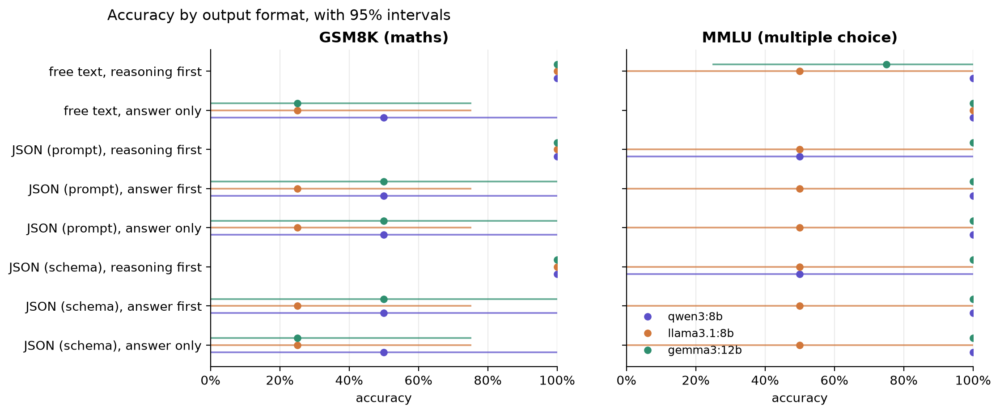
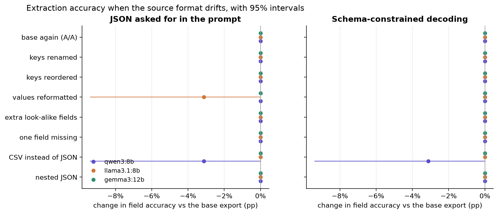

# Results (pilot items)

Generated by `ftax report` from `results/answers/`. Intervals are 95% item bootstraps (2,000 draws).

## Part A: accuracy by output format

### gsm8k

| condition | qwen3:8b | llama3.1:8b | gemma3:12b |
|---|---|---|---|
| free text, reasoning first | 100% (n=4, 262 tok) | 100% (n=4, 210 tok) | 100% (n=4, 194 tok) |
| free text, answer only | 50% (n=4, 6 tok) | 25% (n=4, 5 tok) | 25% (n=4, 6 tok) |
| JSON (prompt), reasoning first | 100% (n=4, 131 tok) | 100% (n=4, 121 tok) | 100% (n=4, 178 tok) |
| JSON (prompt), answer first | 50% (n=4, 129 tok) | 25% (n=4, 786 tok) | 50% (n=4, 371 tok) |
| JSON (prompt), answer only | 50% (n=4, 9 tok) | 25% (n=4, 10 tok) | 50% (n=4, 18 tok) |
| JSON (schema), reasoning first | 100% (n=4, 131 tok) | 100% (n=4, 121 tok) | 100% (n=4, 184 tok) |
| JSON (schema), answer first | 50% (n=4, 129 tok) | 25% (n=4, 786 tok) | 50% (n=4, 342 tok) |
| JSON (schema), answer only | 50% (n=4, 9 tok) | 25% (n=4, 10 tok) | 25% (n=4, 8 tok) |
| free text, reasoning first (A/A) | 100% (n=4, 262 tok) | 100% (n=4, 210 tok) | 100% (n=4, 193 tok) |
| JSON (schema), reasoning first (A/A) | 100% (n=4, 131 tok) | 100% (n=4, 121 tok) | 100% (n=4, 184 tok) |

### mmlu

| condition | qwen3:8b | llama3.1:8b | gemma3:12b |
|---|---|---|---|
| free text, reasoning first | 100% (n=4, 422 tok) | 50% (n=4, 352 tok) | 75% (n=4, 303 tok) |
| free text, answer only | 100% (n=4, 4 tok) | 100% (n=4, 4 tok) | 100% (n=4, 4 tok) |
| JSON (prompt), reasoning first | 50% (n=4, 112 tok) | 50% (n=4, 114 tok) | 100% (n=4, 235 tok) |
| JSON (prompt), answer first | 100% (n=4, 113 tok) | 50% (n=4, 149 tok) | 100% (n=4, 242 tok) |
| JSON (prompt), answer only | 100% (n=4, 7 tok) | 50% (n=4, 10 tok) | 100% (n=4, 17 tok) |
| JSON (schema), reasoning first | 50% (n=4, 112 tok) | 50% (n=4, 114 tok) | 100% (n=4, 226 tok) |
| JSON (schema), answer first | 100% (n=4, 113 tok) | 50% (n=4, 149 tok) | 100% (n=4, 207 tok) |
| JSON (schema), answer only | 100% (n=4, 7 tok) | 50% (n=4, 10 tok) | 100% (n=4, 7 tok) |
| free text, reasoning first (A/A) | 100% (n=4, 422 tok) | 50% (n=4, 352 tok) | 75% (n=4, 303 tok) |
| JSON (schema), reasoning first (A/A) | 50% (n=4, 112 tok) | 50% (n=4, 103 tok) | 100% (n=4, 227 tok) |

## Part A: contrasts (pp, paired by item)

| task | model | contrast | diff | 95% CI | n |
|---|---|---|---|---|---|
| gsm8k | qwen3:8b | reasoning helps (free text) | +50.0 | [+0.0, +100.0] | 4 |
| gsm8k | qwen3:8b | JSON tax, reasoning first (prompt) | +0.0 | [+0.0, +0.0] | 4 |
| gsm8k | qwen3:8b | JSON tax, reasoning first (schema) | +0.0 | [+0.0, +0.0] | 4 |
| gsm8k | qwen3:8b | answer first vs reasoning first (prompt) | -50.0 | [-100.0, +0.0] | 4 |
| gsm8k | qwen3:8b | answer first vs reasoning first (schema) | -50.0 | [-100.0, +0.0] | 4 |
| gsm8k | qwen3:8b | answer first vs answer only (prompt) | +0.0 | [+0.0, +0.0] | 4 |
| gsm8k | qwen3:8b | JSON tax, answer only (prompt) | +0.0 | [+0.0, +0.0] | 4 |
| gsm8k | qwen3:8b | schema vs prompt, reasoning first | +0.0 | [+0.0, +0.0] | 4 |
| gsm8k | qwen3:8b | schema vs prompt, answer first | +0.0 | [+0.0, +0.0] | 4 |
| gsm8k | qwen3:8b | schema vs prompt, answer only | +0.0 | [+0.0, +0.0] | 4 |
| gsm8k | llama3.1:8b | reasoning helps (free text) | +75.0 | [+25.0, +100.0] | 4 |
| gsm8k | llama3.1:8b | JSON tax, reasoning first (prompt) | +0.0 | [+0.0, +0.0] | 4 |
| gsm8k | llama3.1:8b | JSON tax, reasoning first (schema) | +0.0 | [+0.0, +0.0] | 4 |
| gsm8k | llama3.1:8b | answer first vs reasoning first (prompt) | -75.0 | [-100.0, -25.0] | 4 |
| gsm8k | llama3.1:8b | answer first vs reasoning first (schema) | -75.0 | [-100.0, -25.0] | 4 |
| gsm8k | llama3.1:8b | answer first vs answer only (prompt) | +0.0 | [+0.0, +0.0] | 4 |
| gsm8k | llama3.1:8b | JSON tax, answer only (prompt) | +0.0 | [+0.0, +0.0] | 4 |
| gsm8k | llama3.1:8b | schema vs prompt, reasoning first | +0.0 | [+0.0, +0.0] | 4 |
| gsm8k | llama3.1:8b | schema vs prompt, answer first | +0.0 | [+0.0, +0.0] | 4 |
| gsm8k | llama3.1:8b | schema vs prompt, answer only | +0.0 | [+0.0, +0.0] | 4 |
| gsm8k | gemma3:12b | reasoning helps (free text) | +75.0 | [+25.0, +100.0] | 4 |
| gsm8k | gemma3:12b | JSON tax, reasoning first (prompt) | +0.0 | [+0.0, +0.0] | 4 |
| gsm8k | gemma3:12b | JSON tax, reasoning first (schema) | +0.0 | [+0.0, +0.0] | 4 |
| gsm8k | gemma3:12b | answer first vs reasoning first (prompt) | -50.0 | [-100.0, +0.0] | 4 |
| gsm8k | gemma3:12b | answer first vs reasoning first (schema) | -50.0 | [-100.0, +0.0] | 4 |
| gsm8k | gemma3:12b | answer first vs answer only (prompt) | +0.0 | [+0.0, +0.0] | 4 |
| gsm8k | gemma3:12b | JSON tax, answer only (prompt) | +25.0 | [+0.0, +75.0] | 4 |
| gsm8k | gemma3:12b | schema vs prompt, reasoning first | +0.0 | [+0.0, +0.0] | 4 |
| gsm8k | gemma3:12b | schema vs prompt, answer first | +0.0 | [+0.0, +0.0] | 4 |
| gsm8k | gemma3:12b | schema vs prompt, answer only | -25.0 | [-75.0, +0.0] | 4 |
| mmlu | qwen3:8b | reasoning helps (free text) | +0.0 | [+0.0, +0.0] | 4 |
| mmlu | qwen3:8b | JSON tax, reasoning first (prompt) | -50.0 | [-100.0, +0.0] | 4 |
| mmlu | qwen3:8b | JSON tax, reasoning first (schema) | -50.0 | [-100.0, +0.0] | 4 |
| mmlu | qwen3:8b | answer first vs reasoning first (prompt) | +50.0 | [+0.0, +100.0] | 4 |
| mmlu | qwen3:8b | answer first vs reasoning first (schema) | +50.0 | [+0.0, +100.0] | 4 |
| mmlu | qwen3:8b | answer first vs answer only (prompt) | +0.0 | [+0.0, +0.0] | 4 |
| mmlu | qwen3:8b | JSON tax, answer only (prompt) | +0.0 | [+0.0, +0.0] | 4 |
| mmlu | qwen3:8b | schema vs prompt, reasoning first | +0.0 | [+0.0, +0.0] | 4 |
| mmlu | qwen3:8b | schema vs prompt, answer first | +0.0 | [+0.0, +0.0] | 4 |
| mmlu | qwen3:8b | schema vs prompt, answer only | +0.0 | [+0.0, +0.0] | 4 |
| mmlu | llama3.1:8b | reasoning helps (free text) | -50.0 | [-100.0, +0.0] | 4 |
| mmlu | llama3.1:8b | JSON tax, reasoning first (prompt) | +0.0 | [+0.0, +0.0] | 4 |
| mmlu | llama3.1:8b | JSON tax, reasoning first (schema) | +0.0 | [+0.0, +0.0] | 4 |
| mmlu | llama3.1:8b | answer first vs reasoning first (prompt) | +0.0 | [+0.0, +0.0] | 4 |
| mmlu | llama3.1:8b | answer first vs reasoning first (schema) | +0.0 | [+0.0, +0.0] | 4 |
| mmlu | llama3.1:8b | answer first vs answer only (prompt) | +0.0 | [+0.0, +0.0] | 4 |
| mmlu | llama3.1:8b | JSON tax, answer only (prompt) | -50.0 | [-100.0, +0.0] | 4 |
| mmlu | llama3.1:8b | schema vs prompt, reasoning first | +0.0 | [+0.0, +0.0] | 4 |
| mmlu | llama3.1:8b | schema vs prompt, answer first | +0.0 | [+0.0, +0.0] | 4 |
| mmlu | llama3.1:8b | schema vs prompt, answer only | +0.0 | [+0.0, +0.0] | 4 |
| mmlu | gemma3:12b | reasoning helps (free text) | -25.0 | [-75.0, +0.0] | 4 |
| mmlu | gemma3:12b | JSON tax, reasoning first (prompt) | +25.0 | [+0.0, +75.0] | 4 |
| mmlu | gemma3:12b | JSON tax, reasoning first (schema) | +25.0 | [+0.0, +75.0] | 4 |
| mmlu | gemma3:12b | answer first vs reasoning first (prompt) | +0.0 | [+0.0, +0.0] | 4 |
| mmlu | gemma3:12b | answer first vs reasoning first (schema) | +0.0 | [+0.0, +0.0] | 4 |
| mmlu | gemma3:12b | answer first vs answer only (prompt) | +0.0 | [+0.0, +0.0] | 4 |
| mmlu | gemma3:12b | JSON tax, answer only (prompt) | +0.0 | [+0.0, +0.0] | 4 |
| mmlu | gemma3:12b | schema vs prompt, reasoning first | +0.0 | [+0.0, +0.0] | 4 |
| mmlu | gemma3:12b | schema vs prompt, answer first | +0.0 | [+0.0, +0.0] | 4 |
| mmlu | gemma3:12b | schema vs prompt, answer only | +0.0 | [+0.0, +0.0] | 4 |

## Part A: JSON validity

`accuracy` counts a reply with no valid JSON answer as wrong; `as written` scores the value written after `"answer":` even when the JSON never closed. `found` = a JSON object with a usable answer anywhere in the reply; `strict` = the whole reply is that object; `rescued` = invalid replies a free-text parser would have scored right.

| task | model | condition | accuracy | as written | found | strict | rescued | truncated |
|---|---|---|---|---|---|---|---|---|
| gsm8k | gemma3:12b | JSON (prompt), answer first | 50% | 50% | 75% | 0% | 1 | 1 |
| gsm8k | gemma3:12b | JSON (prompt), reasoning first | 100% | 100% | 100% | 0% | 0 | 0 |
| gsm8k | gemma3:12b | JSON (prompt), answer only | 50% | 50% | 100% | 0% | 0 | 0 |
| gsm8k | gemma3:12b | JSON (schema), answer first | 50% | 50% | 75% | 75% | 0 | 1 |
| gsm8k | gemma3:12b | JSON (schema), reasoning first | 100% | 100% | 100% | 100% | 0 | 0 |
| gsm8k | gemma3:12b | JSON (schema), answer only | 25% | 25% | 100% | 100% | 0 | 0 |
| mmlu | gemma3:12b | JSON (prompt), answer first | 100% | 100% | 100% | 0% | 0 | 0 |
| mmlu | gemma3:12b | JSON (prompt), reasoning first | 100% | 100% | 100% | 0% | 0 | 0 |
| mmlu | gemma3:12b | JSON (prompt), answer only | 100% | 100% | 100% | 0% | 0 | 0 |
| mmlu | gemma3:12b | JSON (schema), answer first | 100% | 100% | 100% | 100% | 0 | 0 |
| mmlu | gemma3:12b | JSON (schema), reasoning first | 100% | 100% | 100% | 100% | 0 | 0 |
| mmlu | gemma3:12b | JSON (schema), answer only | 100% | 100% | 100% | 100% | 0 | 0 |
| gsm8k | llama3.1:8b | JSON (prompt), answer first | 25% | 25% | 25% | 25% | 1 | 3 |
| gsm8k | llama3.1:8b | JSON (prompt), reasoning first | 100% | 100% | 100% | 100% | 0 | 0 |
| gsm8k | llama3.1:8b | JSON (prompt), answer only | 25% | 25% | 100% | 100% | 0 | 0 |
| gsm8k | llama3.1:8b | JSON (schema), answer first | 25% | 25% | 25% | 25% | 1 | 3 |
| gsm8k | llama3.1:8b | JSON (schema), reasoning first | 100% | 100% | 100% | 100% | 0 | 0 |
| gsm8k | llama3.1:8b | JSON (schema), answer only | 25% | 25% | 100% | 100% | 0 | 0 |
| mmlu | llama3.1:8b | JSON (prompt), answer first | 50% | 50% | 100% | 100% | 0 | 0 |
| mmlu | llama3.1:8b | JSON (prompt), reasoning first | 50% | 50% | 100% | 100% | 0 | 0 |
| mmlu | llama3.1:8b | JSON (prompt), answer only | 50% | 50% | 100% | 100% | 0 | 0 |
| mmlu | llama3.1:8b | JSON (schema), answer first | 50% | 50% | 100% | 100% | 0 | 0 |
| mmlu | llama3.1:8b | JSON (schema), reasoning first | 50% | 50% | 100% | 100% | 0 | 0 |
| mmlu | llama3.1:8b | JSON (schema), answer only | 50% | 50% | 100% | 100% | 0 | 0 |
| gsm8k | qwen3:8b | JSON (prompt), answer first | 50% | 50% | 100% | 100% | 0 | 0 |
| gsm8k | qwen3:8b | JSON (prompt), reasoning first | 100% | 100% | 100% | 100% | 0 | 0 |
| gsm8k | qwen3:8b | JSON (prompt), answer only | 50% | 50% | 100% | 100% | 0 | 0 |
| gsm8k | qwen3:8b | JSON (schema), answer first | 50% | 50% | 100% | 100% | 0 | 0 |
| gsm8k | qwen3:8b | JSON (schema), reasoning first | 100% | 100% | 100% | 100% | 0 | 0 |
| gsm8k | qwen3:8b | JSON (schema), answer only | 50% | 50% | 100% | 100% | 0 | 0 |
| mmlu | qwen3:8b | JSON (prompt), answer first | 100% | 100% | 100% | 100% | 0 | 0 |
| mmlu | qwen3:8b | JSON (prompt), reasoning first | 50% | 50% | 100% | 100% | 0 | 0 |
| mmlu | qwen3:8b | JSON (prompt), answer only | 100% | 100% | 100% | 100% | 0 | 0 |
| mmlu | qwen3:8b | JSON (schema), answer first | 100% | 100% | 100% | 100% | 0 | 0 |
| mmlu | qwen3:8b | JSON (schema), reasoning first | 50% | 50% | 100% | 100% | 0 | 0 |
| mmlu | qwen3:8b | JSON (schema), answer only | 100% | 100% | 100% | 100% | 0 | 0 |

## Part A: answer first, then reasoning (GSM8K)

How often the reasoning written after the answer ends on a different number.

| model | condition | replies with both | differ | rate | later number right | answer right |
|---|---|---|---|---|---|---|
| gemma3:12b | JSON (prompt), answer first | 3 | 1 | 33.3% | 1 | 0 |
| gemma3:12b | JSON (schema), answer first | 3 | 0 | 0.0% | 0 | 0 |
| llama3.1:8b | JSON (prompt), answer first | 1 | 0 | 0.0% | 0 | 0 |
| llama3.1:8b | JSON (schema), answer first | 1 | 0 | 0.0% | 0 | 0 |
| qwen3:8b | JSON (prompt), answer first | 4 | 1 | 25.0% | 1 | 0 |
| qwen3:8b | JSON (schema), answer first | 4 | 1 | 25.0% | 1 | 0 |

## Part A: noise floor (A/A)

| task | model | condition | answers changed | rate |
|---|---|---|---|---|
| gsm8k | gemma3:12b | free text, reasoning first | 0/4 | 0.0% |
| gsm8k | gemma3:12b | JSON (schema), reasoning first | 0/4 | 0.0% |
| mmlu | gemma3:12b | free text, reasoning first | 0/4 | 0.0% |
| mmlu | gemma3:12b | JSON (schema), reasoning first | 0/4 | 0.0% |
| gsm8k | llama3.1:8b | free text, reasoning first | 0/4 | 0.0% |
| gsm8k | llama3.1:8b | JSON (schema), reasoning first | 0/4 | 0.0% |
| mmlu | llama3.1:8b | free text, reasoning first | 0/4 | 0.0% |
| mmlu | llama3.1:8b | JSON (schema), reasoning first | 0/4 | 0.0% |
| gsm8k | qwen3:8b | free text, reasoning first | 0/4 | 0.0% |
| gsm8k | qwen3:8b | JSON (schema), reasoning first | 0/4 | 0.0% |
| mmlu | qwen3:8b | free text, reasoning first | 0/4 | 0.0% |
| mmlu | qwen3:8b | JSON (schema), reasoning first | 0/4 | 0.0% |

## Part B: field accuracy by source format

Field accuracy / whole-record exact match.

| source format | qwen3:8b json | qwen3:8b schema | llama3.1:8b json | llama3.1:8b schema | gemma3:12b json | gemma3:12b schema |
|---|---|---|---|---|---|---|
| base JSON export | 100.0% / 100% | 100.0% / 100% | 100.0% / 100% | 100.0% / 100% | 100.0% / 100% | 100.0% / 100% |
| base again (A/A) | 100.0% / 100% | 100.0% / 100% | 100.0% / 100% | 100.0% / 100% | 100.0% / 100% | 100.0% / 100% |
| keys renamed | 100.0% / 100% | 100.0% / 100% | 100.0% / 100% | 100.0% / 100% | 100.0% / 100% | 100.0% / 100% |
| keys reordered | 100.0% / 100% | 100.0% / 100% | 100.0% / 100% | 100.0% / 100% | 100.0% / 100% | 100.0% / 100% |
| values reformatted | 100.0% / 100% | 100.0% / 100% | 96.9% / 75% | 100.0% / 100% | 100.0% / 100% | 100.0% / 100% |
| extra look-alike fields | 100.0% / 100% | 100.0% / 100% | 100.0% / 100% | 100.0% / 100% | 100.0% / 100% | 100.0% / 100% |
| one field missing | 100.0% / 100% | 100.0% / 100% | 100.0% / 100% | 100.0% / 100% | 100.0% / 100% | 100.0% / 100% |
| CSV instead of JSON | 96.9% / 75% | 96.9% / 75% | 100.0% / 100% | 100.0% / 100% | 100.0% / 100% | 100.0% / 100% |
| nested JSON | 100.0% / 100% | 100.0% / 100% | 100.0% / 100% | 100.0% / 100% | 100.0% / 100% | 100.0% / 100% |

## Part B: contrasts (pp of field accuracy, paired by record)

| model | mode | source format | diff | 95% CI |
|---|---|---|---|---|
| qwen3:8b | json | base again (A/A) | +0.0 | [+0.0, +0.0] |
| qwen3:8b | json | keys renamed | +0.0 | [+0.0, +0.0] |
| qwen3:8b | json | keys reordered | +0.0 | [+0.0, +0.0] |
| qwen3:8b | json | values reformatted | +0.0 | [+0.0, +0.0] |
| qwen3:8b | json | extra look-alike fields | +0.0 | [+0.0, +0.0] |
| qwen3:8b | json | one field missing | +0.0 | [+0.0, +0.0] |
| qwen3:8b | json | CSV instead of JSON | -3.1 | [-9.4, +0.0] |
| qwen3:8b | json | nested JSON | +0.0 | [+0.0, +0.0] |
| qwen3:8b | schema | base again (A/A) | +0.0 | [+0.0, +0.0] |
| qwen3:8b | schema | keys renamed | +0.0 | [+0.0, +0.0] |
| qwen3:8b | schema | keys reordered | +0.0 | [+0.0, +0.0] |
| qwen3:8b | schema | values reformatted | +0.0 | [+0.0, +0.0] |
| qwen3:8b | schema | extra look-alike fields | +0.0 | [+0.0, +0.0] |
| qwen3:8b | schema | one field missing | +0.0 | [+0.0, +0.0] |
| qwen3:8b | schema | CSV instead of JSON | -3.1 | [-9.4, +0.0] |
| qwen3:8b | schema | nested JSON | +0.0 | [+0.0, +0.0] |
| qwen3:8b | schema minus json | base JSON export | +0.0 | [+0.0, +0.0] |
| qwen3:8b | schema minus json | base again (A/A) | +0.0 | [+0.0, +0.0] |
| qwen3:8b | schema minus json | keys renamed | +0.0 | [+0.0, +0.0] |
| qwen3:8b | schema minus json | keys reordered | +0.0 | [+0.0, +0.0] |
| qwen3:8b | schema minus json | values reformatted | +0.0 | [+0.0, +0.0] |
| qwen3:8b | schema minus json | extra look-alike fields | +0.0 | [+0.0, +0.0] |
| qwen3:8b | schema minus json | one field missing | +0.0 | [+0.0, +0.0] |
| qwen3:8b | schema minus json | CSV instead of JSON | +0.0 | [+0.0, +0.0] |
| qwen3:8b | schema minus json | nested JSON | +0.0 | [+0.0, +0.0] |
| llama3.1:8b | json | base again (A/A) | +0.0 | [+0.0, +0.0] |
| llama3.1:8b | json | keys renamed | +0.0 | [+0.0, +0.0] |
| llama3.1:8b | json | keys reordered | +0.0 | [+0.0, +0.0] |
| llama3.1:8b | json | values reformatted | -3.1 | [-9.4, +0.0] |
| llama3.1:8b | json | extra look-alike fields | +0.0 | [+0.0, +0.0] |
| llama3.1:8b | json | one field missing | +0.0 | [+0.0, +0.0] |
| llama3.1:8b | json | CSV instead of JSON | +0.0 | [+0.0, +0.0] |
| llama3.1:8b | json | nested JSON | +0.0 | [+0.0, +0.0] |
| llama3.1:8b | schema | base again (A/A) | +0.0 | [+0.0, +0.0] |
| llama3.1:8b | schema | keys renamed | +0.0 | [+0.0, +0.0] |
| llama3.1:8b | schema | keys reordered | +0.0 | [+0.0, +0.0] |
| llama3.1:8b | schema | values reformatted | +0.0 | [+0.0, +0.0] |
| llama3.1:8b | schema | extra look-alike fields | +0.0 | [+0.0, +0.0] |
| llama3.1:8b | schema | one field missing | +0.0 | [+0.0, +0.0] |
| llama3.1:8b | schema | CSV instead of JSON | +0.0 | [+0.0, +0.0] |
| llama3.1:8b | schema | nested JSON | +0.0 | [+0.0, +0.0] |
| llama3.1:8b | schema minus json | base JSON export | +0.0 | [+0.0, +0.0] |
| llama3.1:8b | schema minus json | base again (A/A) | +0.0 | [+0.0, +0.0] |
| llama3.1:8b | schema minus json | keys renamed | +0.0 | [+0.0, +0.0] |
| llama3.1:8b | schema minus json | keys reordered | +0.0 | [+0.0, +0.0] |
| llama3.1:8b | schema minus json | values reformatted | +3.1 | [+0.0, +9.4] |
| llama3.1:8b | schema minus json | extra look-alike fields | +0.0 | [+0.0, +0.0] |
| llama3.1:8b | schema minus json | one field missing | +0.0 | [+0.0, +0.0] |
| llama3.1:8b | schema minus json | CSV instead of JSON | +0.0 | [+0.0, +0.0] |
| llama3.1:8b | schema minus json | nested JSON | +0.0 | [+0.0, +0.0] |
| gemma3:12b | json | base again (A/A) | +0.0 | [+0.0, +0.0] |
| gemma3:12b | json | keys renamed | +0.0 | [+0.0, +0.0] |
| gemma3:12b | json | keys reordered | +0.0 | [+0.0, +0.0] |
| gemma3:12b | json | values reformatted | +0.0 | [+0.0, +0.0] |
| gemma3:12b | json | extra look-alike fields | +0.0 | [+0.0, +0.0] |
| gemma3:12b | json | one field missing | +0.0 | [+0.0, +0.0] |
| gemma3:12b | json | CSV instead of JSON | +0.0 | [+0.0, +0.0] |
| gemma3:12b | json | nested JSON | +0.0 | [+0.0, +0.0] |
| gemma3:12b | schema | base again (A/A) | +0.0 | [+0.0, +0.0] |
| gemma3:12b | schema | keys renamed | +0.0 | [+0.0, +0.0] |
| gemma3:12b | schema | keys reordered | +0.0 | [+0.0, +0.0] |
| gemma3:12b | schema | values reformatted | +0.0 | [+0.0, +0.0] |
| gemma3:12b | schema | extra look-alike fields | +0.0 | [+0.0, +0.0] |
| gemma3:12b | schema | one field missing | +0.0 | [+0.0, +0.0] |
| gemma3:12b | schema | CSV instead of JSON | +0.0 | [+0.0, +0.0] |
| gemma3:12b | schema | nested JSON | +0.0 | [+0.0, +0.0] |
| gemma3:12b | schema minus json | base JSON export | +0.0 | [+0.0, +0.0] |
| gemma3:12b | schema minus json | base again (A/A) | +0.0 | [+0.0, +0.0] |
| gemma3:12b | schema minus json | keys renamed | +0.0 | [+0.0, +0.0] |
| gemma3:12b | schema minus json | keys reordered | +0.0 | [+0.0, +0.0] |
| gemma3:12b | schema minus json | values reformatted | +0.0 | [+0.0, +0.0] |
| gemma3:12b | schema minus json | extra look-alike fields | +0.0 | [+0.0, +0.0] |
| gemma3:12b | schema minus json | one field missing | +0.0 | [+0.0, +0.0] |
| gemma3:12b | schema minus json | CSV instead of JSON | +0.0 | [+0.0, +0.0] |
| gemma3:12b | schema minus json | nested JSON | +0.0 | [+0.0, +0.0] |

## Part B: reformatted values, on the changed fields only

| model | mode | field | n | reformatted | base | diff | 95% CI |
|---|---|---|---|---|---|---|---|
| gemma3:12b | json | all | 6 | 100.0% | 100.0% | +0.0 | [+0.0, +0.0] |
| gemma3:12b | json | customer_rating | 1 | 100.0% | 100.0% | +0.0 | [+0.0, +0.0] |
| gemma3:12b | json | family_friendly | 4 | 100.0% | 100.0% | +0.0 | [+0.0, +0.0] |
| gemma3:12b | json | price_range | 1 | 100.0% | 100.0% | +0.0 | [+0.0, +0.0] |
| gemma3:12b | schema | all | 6 | 100.0% | 100.0% | +0.0 | [+0.0, +0.0] |
| gemma3:12b | schema | customer_rating | 1 | 100.0% | 100.0% | +0.0 | [+0.0, +0.0] |
| gemma3:12b | schema | family_friendly | 4 | 100.0% | 100.0% | +0.0 | [+0.0, +0.0] |
| gemma3:12b | schema | price_range | 1 | 100.0% | 100.0% | +0.0 | [+0.0, +0.0] |
| llama3.1:8b | json | all | 6 | 83.3% | 100.0% | -12.5 | [-37.5, +0.0] |
| llama3.1:8b | json | customer_rating | 1 | 100.0% | 100.0% | +0.0 | [+0.0, +0.0] |
| llama3.1:8b | json | family_friendly | 4 | 100.0% | 100.0% | +0.0 | [+0.0, +0.0] |
| llama3.1:8b | json | price_range | 1 | 0.0% | 100.0% | -100.0 | [-100.0, -100.0] |
| llama3.1:8b | schema | all | 6 | 100.0% | 100.0% | +0.0 | [+0.0, +0.0] |
| llama3.1:8b | schema | customer_rating | 1 | 100.0% | 100.0% | +0.0 | [+0.0, +0.0] |
| llama3.1:8b | schema | family_friendly | 4 | 100.0% | 100.0% | +0.0 | [+0.0, +0.0] |
| llama3.1:8b | schema | price_range | 1 | 100.0% | 100.0% | +0.0 | [+0.0, +0.0] |
| qwen3:8b | json | all | 6 | 100.0% | 100.0% | +0.0 | [+0.0, +0.0] |
| qwen3:8b | json | customer_rating | 1 | 100.0% | 100.0% | +0.0 | [+0.0, +0.0] |
| qwen3:8b | json | family_friendly | 4 | 100.0% | 100.0% | +0.0 | [+0.0, +0.0] |
| qwen3:8b | json | price_range | 1 | 100.0% | 100.0% | +0.0 | [+0.0, +0.0] |
| qwen3:8b | schema | all | 6 | 100.0% | 100.0% | +0.0 | [+0.0, +0.0] |
| qwen3:8b | schema | customer_rating | 1 | 100.0% | 100.0% | +0.0 | [+0.0, +0.0] |
| qwen3:8b | schema | family_friendly | 4 | 100.0% | 100.0% | +0.0 | [+0.0, +0.0] |
| qwen3:8b | schema | price_range | 1 | 100.0% | 100.0% | +0.0 | [+0.0, +0.0] |

## Part B: a missing field filled in

Share of records where the model gave a value for the removed field, against fields the base record never had.

| model | mode | removed field filled | 95% CI | never-present field filled | n never-present |
|---|---|---|---|---|---|
| gemma3:12b | json | 0.0% | [0.0, 0.0] | 0.0% | 3 |
| gemma3:12b | schema | 0.0% | [0.0, 0.0] | 0.0% | 3 |
| llama3.1:8b | json | 0.0% | [0.0, 0.0] | 0.0% | 3 |
| llama3.1:8b | schema | 0.0% | [0.0, 0.0] | 0.0% | 3 |
| qwen3:8b | json | 0.0% | [0.0, 0.0] | 0.0% | 3 |
| qwen3:8b | schema | 0.0% | [0.0, 0.0] | 0.0% | 3 |

## Part B: look-alike fields taken

| model | mode | records | rate |
|---|---|---|---|
| gemma3:12b | json | 0/4 | 0.0% |
| gemma3:12b | schema | 0/4 | 0.0% |
| llama3.1:8b | json | 0/4 | 0.0% |
| llama3.1:8b | schema | 0/4 | 0.0% |
| qwen3:8b | json | 0/4 | 0.0% |
| qwen3:8b | schema | 0/4 | 0.0% |

## Part B: validity

| model | mode | parsed | strict | exact keys |
|---|---|---|---|---|
| gemma3:12b | json | 100% | 0% | 97% |
| gemma3:12b | schema | 100% | 100% | 100% |
| llama3.1:8b | json | 100% | 0% | 100% |
| llama3.1:8b | schema | 100% | 100% | 100% |
| qwen3:8b | json | 100% | 100% | 100% |
| qwen3:8b | schema | 100% | 100% | 100% |

## Part B: noise floor (A/A)

| model | mode | answers changed |
|---|---|---|
| gemma3:12b | json | 0/4 |
| gemma3:12b | schema | 0/4 |
| llama3.1:8b | json | 0/4 |
| llama3.1:8b | schema | 0/4 |
| qwen3:8b | json | 0/4 |
| qwen3:8b | schema | 0/4 |
